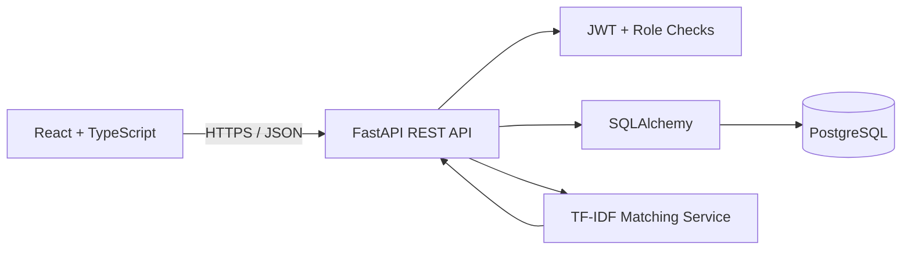
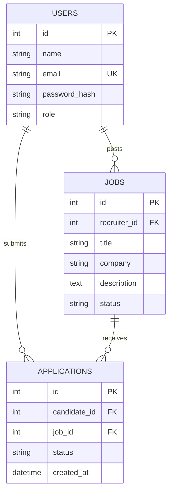

# Architecture

## Core entities

This ER diagram documents only the entities currently implemented in the MVP. Extend it as profile, resume, skills, company, notes, notification, and AI-result tables are added.
